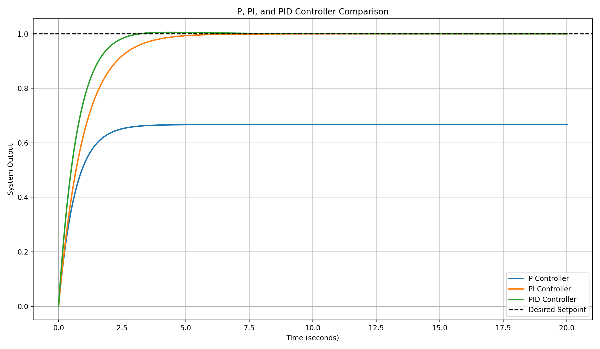

# PID Control Systems Simulator

### Feedback Control Analysis | P, PI & PID Controllers

**Computer Engineering | Marian University**

## Project Overview

This project explores feedback control systems through a Python-based simulation of proportional (P), proportional-integral (PI), and proportional-integral-derivative (PID) controllers.

Inspired by concepts from my Control Systems coursework, this simulation investigates how different controller configurations influence system behavior, including rise time, overshoot, settling time, and steady-state error.

The objective is to connect mathematical modeling and control theory with practical software-based engineering analysis.

## Project Objectives

- Implement P, PI, and PID controllers using Python.
- Simulate the response of a first-order dynamic system.
- Compare controller configurations and their performance.
- Analyze transient and steady-state characteristics.
- Visualize system responses using Matplotlib.
- Explore the effects of controller tuning on stability and accuracy.

## Mathematical Model

The simulation uses a first-order dynamic system described by:

$$
\tau \frac{dy(t)}{dt} + y(t) = K u(t)
$$

Where:

- **τ = 2 seconds** — Plant time constant
- **K = 1** — Plant gain
- **u(t)** — Control input
- **y(t)** — System output

The corresponding transfer function is:

$$
G(s) = \frac{K}{\tau s + 1}
$$

### PID Control Equation

The PID controller is represented by:

$$
u(t) = K_p e(t) + K_i \int_0^t e(\xi)\,d\xi
+ K_d \frac{de(t)}{dt}
$$

Where:

- **Kp** — Proportional gain
- **Ki** — Integral gain
- **Kd** — Derivative gain
- **e(t)** — Difference between the desired setpoint and measured output

Each controller uses different combinations of these terms to regulate system behavior.

## Controller Configurations

The following controller gains are implemented in the simulation:

| Controller | Kp | Ki | Kd |
|---|---:|---:|---:|
| P | 2.0 | 0.0 | 0.0 |
| PI | 2.0 | 1.0 | 0.0 |
| PID | 3.0 | 1.5 | 0.2 |

These configurations allow comparison of how proportional, integral, and derivative actions affect the response.

## Technologies Used

**Programming Language**
- Python

**Libraries**
- NumPy
- Matplotlib

**Engineering Concepts**
- Feedback Control Systems
- Differential Equations
- Transfer Functions
- Numerical Integration
- Transient Response Analysis
- Controller Tuning
- System Stability

## Simulation Methodology

The simulation uses a numerical approximation of the first-order plant dynamics.

### 1. System Initialization

The simulation defines:

- Sampling interval: 0.01 seconds
- Simulation duration: 20 seconds
- Reference setpoint: 1.0
- Plant time constant: 2 seconds
- Plant gain: 1.0

### 2. Error Calculation

At each time step, the controller calculates the difference between the reference and the current output:

$$
e(t) = r(t) - y(t)
$$

### 3. Controller Output

The control signal is calculated using the selected P, PI, or PID gains.

### 4. System Response

The simulated plant output is updated using forward Euler numerical integration.

### 5. Performance Evaluation

The resulting output is analyzed to estimate overshoot, time to reach 90% of the setpoint, settling time, and final-time steady-state error.

## Simulation Results

The program compares the step responses of P, PI, and PID controllers using the same first-order plant.

### Controller Response Comparison



*Figure 1: Simulated step responses comparing P, PI, and PID controllers.*

**Note:** The graph will appear once `pid_response.png` has been generated and uploaded to this repository.

### Performance Metrics

The simulation calculates the following metrics:

**Percentage Overshoot**

$$
M_p = \frac{y_{\max}-r}{r}\times100\%
$$

Overshoot is reported as zero if the output does not exceed the setpoint.

**Time to Reach 90%**

The first time at which the simulated output reaches 90% of the desired setpoint.

**Settling Time**

The time after which the response remains within 2% of the desired setpoint for the rest of the simulation.

**Final-Time Error**

$$
e_f = |r-y(t_f)|
$$

Where `t_f` represents the final simulation time.

The final-time error is an approximation of steady-state behavior, not proof of the asymptotic steady-state error.

## Engineering Analysis

### Proportional (P) Controller

The proportional controller responds to the difference between the desired reference and actual system output.

Increasing proportional gain generally improves response speed for the modeled first-order plant. However, proportional-only control retains a nonzero steady-state error for a constant step input.

### Proportional-Integral (PI) Controller

The integral term accumulates error over time and adjusts the controller output to reduce persistent deviations from the reference.

For a stable closed-loop system, integral action can eliminate steady-state error for a constant reference input.

However, excessive integral gain may increase overshoot or produce undesirable oscillations.

### Proportional-Integral-Derivative (PID) Controller

The PID controller combines proportional, integral, and derivative actions.

The derivative term responds to changes in error and can improve transient behavior when appropriately tuned.

The effectiveness of derivative action depends on the system dynamics, selected gains, and implementation.

### Engineering Tradeoffs

Controller design involves balancing several performance objectives:

- Response speed
- Overshoot
- Settling time
- Steady-state accuracy
- Stability
- Control effort

The fastest controller is not necessarily the best controller. Appropriate tuning depends on the requirements and limitations of the application.

## Running the Project

### Requirements

- Python 3.9 or newer
- NumPy
- Matplotlib

### Installation

Install the required dependencies:

```bash
pip install -r requirements.txt
```

### Execution

Run the simulation:

```bash
python main.py
```

The program prints the calculated performance metrics and generates a comparison graph.

The figure is saved as:

`pid_response.png`

## Applications

The concepts demonstrated in this project are relevant to:

- Robotics and Motion Control
- Industrial Automation
- Motor Speed Regulation
- Embedded Control Systems
- Manufacturing Equipment
- Process Control
- Mechatronic Systems

## Development Roadmap

- [x] Implement P, PI, and PID control algorithms.
- [x] Simulate first-order plant dynamics.
- [x] Implement numerical integration.
- [x] Calculate response performance metrics.
- [x] Generate step-response visualization code.
- [ ] Compare additional controller gain configurations.
- [ ] Implement second-order plant models.
- [ ] Investigate external disturbances.
- [ ] Add actuator saturation and anti-windup.
- [ ] Explore hardware-based control applications.

## Project Limitations

This project is an educational simulation using a simplified mathematical model.

The current implementation does not include:

- Physical hardware measurements
- Sensor noise
- Actuator saturation
- Integral anti-windup
- Experimental validation

The numerical simulation uses a fixed time step, and its results may vary with the integration method and controller parameters.

## Future Development

Future work could expand this simulation to second-order systems, compare different numerical integration methods, and evaluate how disturbances affect controller performance.

Another potential improvement is exploring how the simulated control algorithms could be implemented in embedded hardware.

## Academic Context

This project was created as a portfolio example inspired by topics studied in my Computer Engineering Control Systems coursework at Marian University.

It demonstrates a preliminary software implementation of feedback control concepts and provides a foundation for additional experiments and engineering analysis.
